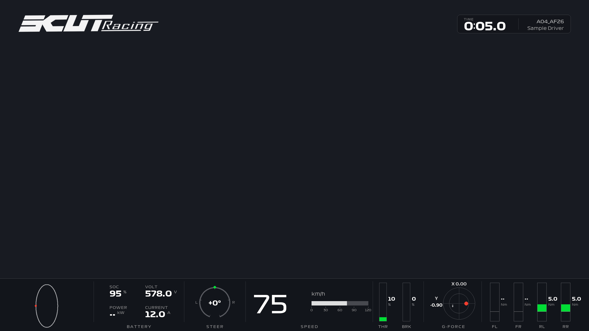

# AIM Telemetry Overlay (2K @ 100 FPS)

> 为大学生方程式赛车 (FSAE) 及高性能赛车量身打造的 AIM 遥测数据动态 HUD 仪表透明通道视频渲染套件。



---

## 🌟 核心特性

- 🏎️ **广播级画质与帧率**：原生输出 **2560×1440 (2K)** 分辨率，**100 FPS** 超高帧率，精准还原传感器与车载运动相机（GoPro / Insta360）的每一毫秒动态。
- 🎬 **真 Alpha 透明通道导出**：支持 **QuickTime Animation (QTRLE)** 与 **Apple ProRes 4444** 透明 MOV 格式，可直接作为顶层图层拖入 **剪映 / Premiere / Final Cut Pro / DaVinci Resolve**，无需复杂抠像或绿幕调节。
- ⚡ **多进程切片极速加速**：内置基于 Multi-Processing 的多核心分块并行渲染引擎，充分榨干 AMD Ryzen / Intel 多核 CPU 性能，渲染效率提升数倍。
- 🖥️ **现代化深色工作台**：基于 PySide6 构建的 Linear 质感桌面 GUI，支持 CSV 拖拽解析、元数据自动提取、进程核心数调配、实时进度及剩余时间（ETA）预估。
- 📊 **深度集成的赛车数据舱**：
  - **车队标识**：左上角车队 Logo。
  - **计时与车手**：右上角动态圈时计时条、车手姓名与赛车编号。
  - **一体化底部 HUD 仪表带**：
    - **GPS 轨迹**：赛道迷你地图与实时轨迹红点定位；
    - **三电状态**：高压动力电池 SOC、总压 (V)、瞬时输出功率 (kW)、电流 (A)；
    - **转向状态**：±160° 物理转向角圆环，实时显示带符号转向度数（左正右负）；
    - **车速刻度**：0~120 km/h 数字速度与方正刻度动态条；
    - **踏板行程**：油门 (THR) / 刹车 (BRK) 柱状图与实时百分比开度；
    - **G 力姿态**：XY 双轴惯性加速度十字圆盘；
    - **电机扭矩**：四轮独立电机瞬时扭矩条与数值显示（FL / FR / RL / RR）。

---

## 🚀 即开即用指南

本仓库已做好完整依赖与示例数据打包，下载源码后即可直接运行。

### 方式 A：一键启动桌面工作台（推荐）

1. **环境准备**：确保电脑已安装 [Python 3.10+](https://www.python.org/)（安装时勾选 **Add Python to PATH**）。
2. **双击启动**：双击运行根目录下的 **`启动桌面工作台.bat`**。
   > 💡 **首次运行全自动安装**：脚本会自动检查依赖，若未安装会自动运行 `pip install -r requirements.txt`，完成后自动呼出工作台。
3. **开箱即用测试**：
   - 将项目自带的示例数据 **`examples/sample_telemetry.csv`** 拖入窗口。
   - 确认输出路径与 CPU 进程数后，点击 **「开始导出透明视频」** 即可开始渲染！

### 方式 B：命令行快速渲染（适合批量处理与服务器环境）

```bash
# 1. 安装项目依赖（imageio-ffmpeg 会自动携带免配置的 ffmpeg 二进制）
pip install -r requirements.txt

# 2. 检查遥测数据通道解析与对齐状态
python scripts/dashboard.py inspect examples/sample_telemetry.csv

# 3. 极速渲染透明通道 MOV 视频（默认生成在 output-sample 目录）
python scripts/dashboard.py render examples/sample_telemetry.csv --output output-sample
```

---

## 📁 项目目录结构

```text
aim-telemetry-overlay/
├── 启动桌面工作台.bat      # Windows 一键启动脚本（含自动依赖检测与安装）
├── requirements.txt        # Python 依赖清单
├── .gitignore              # Git 忽略配置（防意外推送大视频及重型原始数据）
├── README.md               # 项目主说明文档
├── examples/               # 示例遥测数据包
│   └── sample_telemetry.csv  # 开箱即用的 100Hz 真实工况标准示例数据
├── assets/                 # 全局预设配置
│   └── default-config.json # 默认 HUD 控件布局与映射参数
├── scripts/                # 核心功能模块
│   ├── app_gui.py          # PySide6 桌面客户端
│   ├── dashboard.py        # 渲染器 CLI 调度主入口
│   ├── render_mp.py        # 多进程切片渲染加速模块
│   ├── telemetry.py        # AIM CSV 遥测数据解析、重采样与对齐
│   ├── widgets.py          # 赛车 HUD 控件绘制引擎（PIL 矢量渲染）
│   ├── hud.py              # HUD 画布封装
│   └── assets/             # 预置字体 (F1 Display, Titillium) 与车队 Logo
└── docs/                   # 详细开发与系统集成文档
```

---

## 🎬 剪辑软件合成使用说明

导出的透明视频（如 `dashboard_100fps_alpha.mov`）可直接无缝嵌入各类剪辑软件中：

| 剪辑软件 | 导入与叠加步骤 |
| :--- | :--- |
| **剪映专业版 (CapCut)** | 直接拖入轨道，放置在车载主画面的**上方轨道**，软件自动识别透明 Alpha 通道。 |
| **Adobe Premiere Pro** | 拖入项目序列上方图层。若颜色偏暗，右键素材 → **修改** → **解释素材** → Alpha 通道设为 **直接 - 无混色 (Straight)**。 |
| **DaVinci Resolve** | 拖入时间线，在检查器中确认 **Alpha 模式** 为 **Straight (直接)**。 |
| **Final Cut Pro** | 放置在 Primary Storyline 上层，自动透明叠化。 |

> 📌 **对齐技巧**：
> 渲染完成后，导出目录内会附带 `使用说明.txt` 和 `report.json`。将透明视频与车载视频在起步/制动点（或红绿灯发车瞬间）进行波形对齐即可完成毫秒级同步。

---

## 💡 性能与硬件调优建议

- **CPU 多进程数设置**：
  - 以 **AMD Ryzen 7 8845H / 7840HS**（8 核 16 线程）为例：
    - **推荐值：8 进程**。让每个渲染工作进程完全独占 1 个 Zen 4 物理大核，不仅耗时最短，还能避免超线程争抢缓存与笔记本过热降频；
    - 散热极佳台式机或追求极限可尝试 10~12 进程；不建议拉满至 16 进程。
- **磁盘性能**：
  - 100 FPS QTRLE 视频写盘速率较高，建议将输出目录放置在高速 NVMe SSD 上。
- **免手动配置 FFmpeg**：
  - 项目通过 `imageio-ffmpeg` 自动管理独立的静态 FFmpeg 执行程序，用户无需手动下载或配置系统环境变量。

---

## 📄 许可证与字体说明

- 本项目代码遵循 MIT License。
- 内置 Formula 1 系列字体仅供车队内部研究、教学与赛车学术交流使用；若需商业发布，请在 `scripts/widgets.py` 中切换为开源商用字体（如 Titillium Web）。
